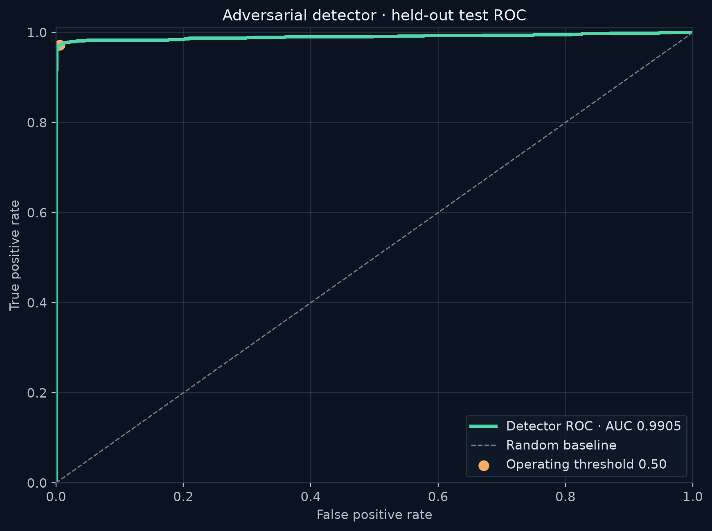
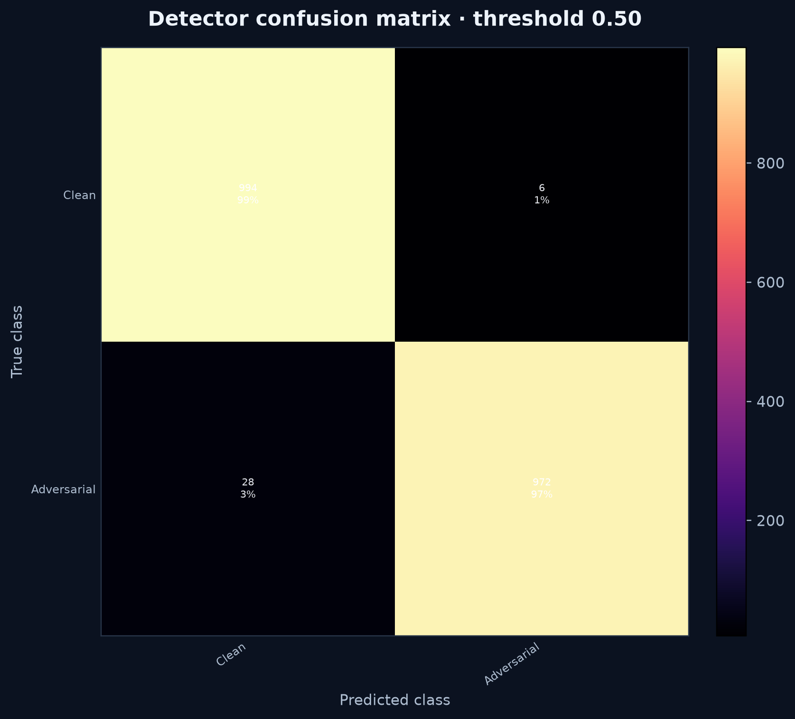
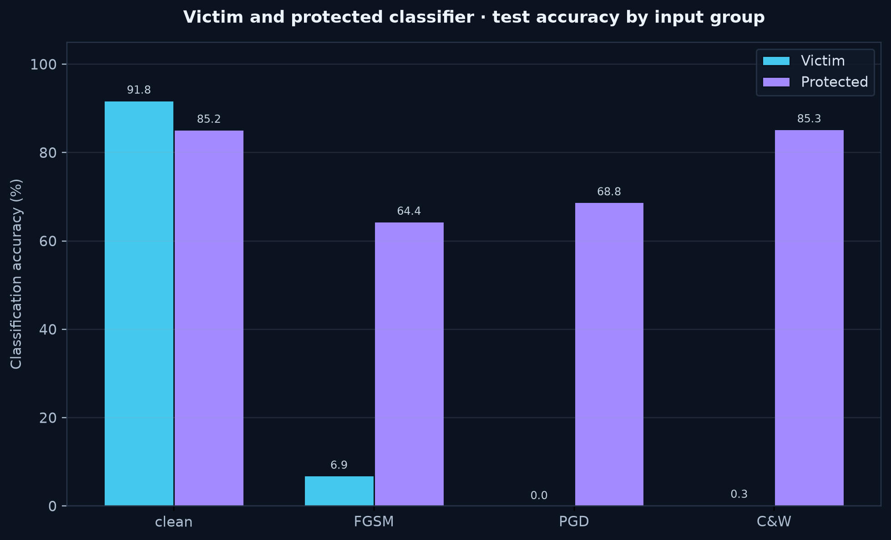
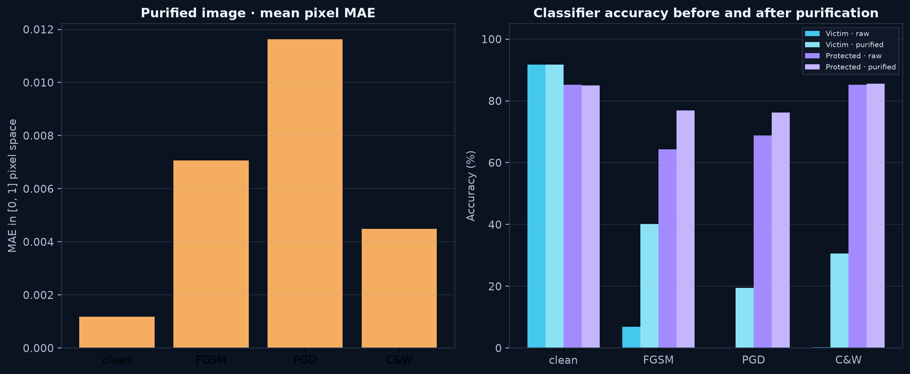

# AdvGuard model evaluation

This report was generated from the held-out `adversarial_dataset/test.pt` split using the local trained checkpoints. The detector was selected on validation data; these figures are test results. The adversarial examples were generated against the victim classifier, so classifier comparisons are non-adaptive.

- Test rows: 2000 (1000 clean, 1000 adversarial).
- Detector threshold: 0.50; accuracy 98.30%; precision 99.39%; recall 97.20%; F1 98.28%; ROC-AUC 0.9905.
- Detector confusion counts: TN 994, FP 6, FN 28, TP 972.
- Clean classifier accuracy: victim 91.80%; protected 85.20%.
- Adversarial purification mean MAE 0.00707, MSE 0.00020 in pixel space.

## Test accuracy by input group

| Group | Samples | Victim raw | Protected raw | Detector rate | Victim purified | Protected purified |
|---|---:|---:|---:|---:|---:|---:|
| clean | 1000 | 91.80% | 85.20% | 0.60% | 91.80% | 85.00% |
| FGSM | 334 | 6.89% | 64.37% | 100.00% | 40.12% | 76.95% |
| PGD | 333 | 0.00% | 68.77% | 100.00% | 19.52% | 76.28% |
| C&W | 333 | 0.30% | 85.29% | 91.59% | 30.63% | 85.59% |

## Visual summary

### Detector performance

### Classifiers and purification

## Artifacts

- `detector_roc_curve.png` — detector operating point and ROC curve.
- `detector_confusion_matrix.png` — binary test confusion matrix, with counts and row rates.
- `classifier_accuracy_by_attack.png` — victim/protected accuracy by attack group.
- `victim_confusion_*.png`, `protected_confusion_*.png` — CIFAR-10 class confusion matrices.
- `purification_evaluation.png` — reconstruction MAE and classifier effects.
- `classification_report.csv` — per-class precision, recall, F1, and support.
- Other CSV files — test metrics, per-row predictions, and purification measurements.

Confidence is not accuracy. Classifier accuracy uses the test split's provided true labels. Reconstruction MAE/MSE are pixel-space errors against each paired clean source image.
